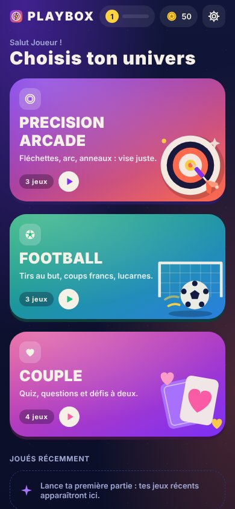
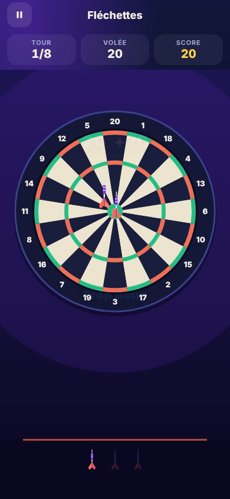
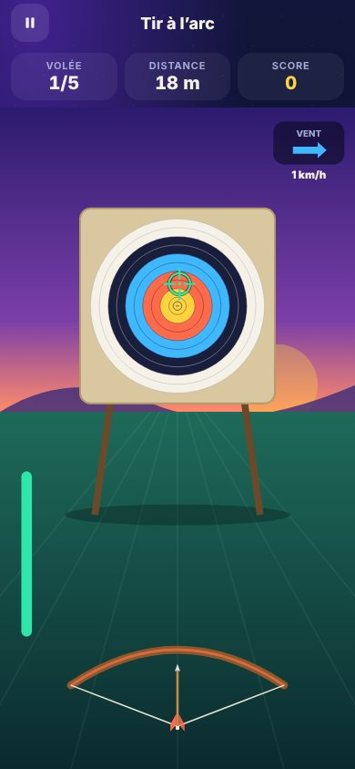
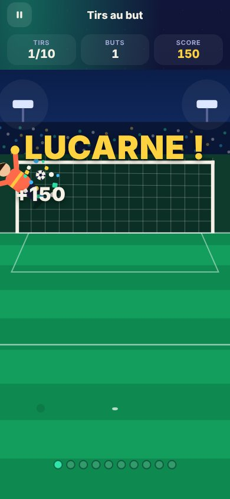
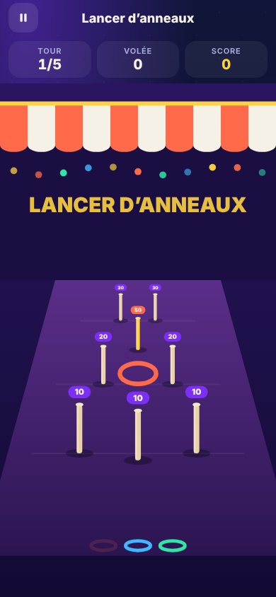
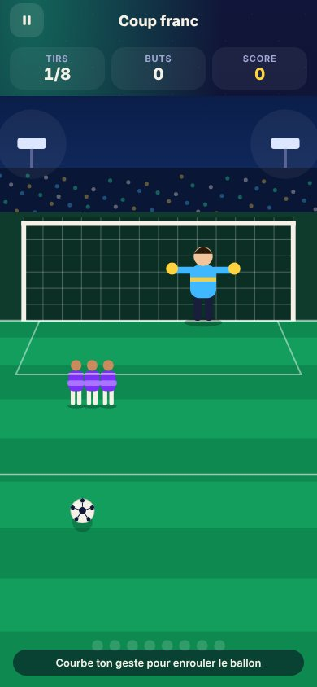
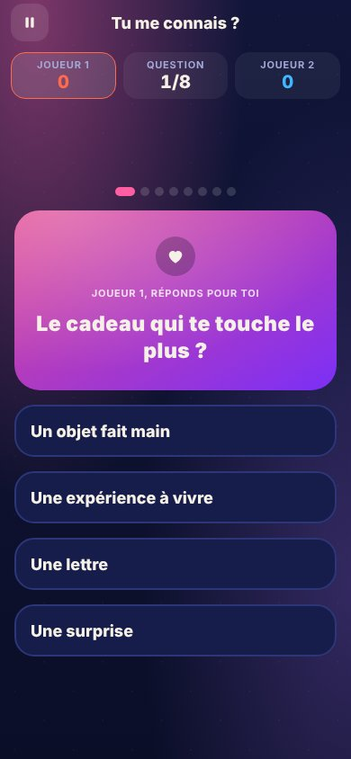
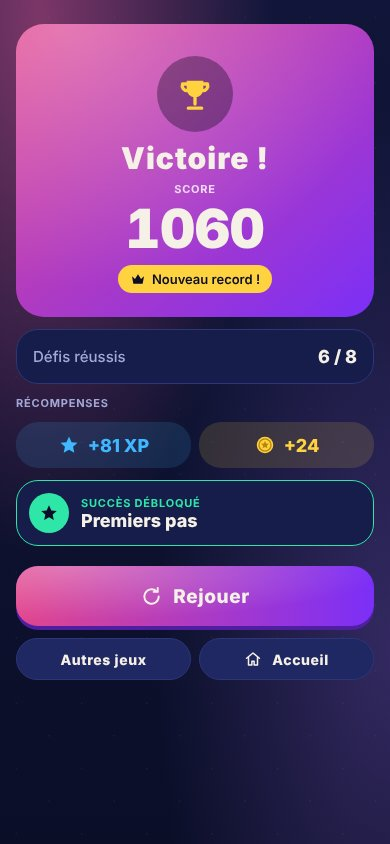

# PLAYBOX ARCADE

Application mobile de mini-jeux (Android et iOS), en français, construite avec **Expo SDK 57**, **React Native 0.86** et **TypeScript**.
Trois univers : **Precision Arcade**, **Football** et **Couple**, avec une progression locale (XP, niveaux, pièces, records, succès, défis du jour, vestiaire).

Tout fonctionne **hors ligne**, sans compte ni serveur. Aucune donnée n'est envoyée.

| Accueil | Fléchettes | Tir à l'arc | Tirs au but |
| --- | --- | --- | --- |
|  |  |  |  |
| **Lancer d'anneaux** | **Coup franc** | **Tu me connais ?** | **Fin de partie** |
|  |  |  |  |

## Démarrer

```bash
cd playbox-arcade
npm install
npx expo start          # puis « a » (Android), « i » (iOS) ou scanner le QR code avec Expo Go
npx expo start --web    # version navigateur, pratique pour tester rapidement
```

Toutes les dépendances font partie du SDK Expo 57 : l'application tourne dans **Expo Go**, sans build natif.
Pour publier sur les stores : `npx eas-cli@latest build -p android|ios` (identifiants `com.playbox.arcade` dans `app.json`).

### Vérifications

```bash
npm test             # 40 tests Jest (logique de jeu, progression, i18n)
npm run typecheck    # tsc --noEmit
npm run lint         # expo lint
```

## Contenu

| Univers | Jeu | Modes | Commandes |
| --- | --- | --- | --- |
| Precision Arcade | Fléchettes | Solo (8 tours), à deux (6 tours chacun) | Viser en glissant, lancer d'un coup sec vers le haut. La force du geste règle la hauteur. |
| | Tir à l'arc | Solo (5 volées), à deux | Maintenir pour bander l'arc, glisser pour viser, relâcher. Vent, distance croissante, fatigue après 3 s. |
| | Lancer d'anneaux | Solo (5 manches), à deux | Glisser vers le haut : direction = quille, force = distance. Quille dorée mobile dès la 3e manche. |
| | Bowling | — | *Bientôt disponible* |
| Football | Tirs au but | Solo (10 tirs), à deux (5 tirs chacun) | Glisser depuis le ballon. Gardien qui lit (ou non) le tir, lucarnes, poteaux, séries. |
| | Coup franc | Solo (8 tirs) | Un geste courbé enroule le ballon autour du mur ; mur qui saute, position variable. |
| | Défi précision | Solo (45 s) | Cibles éphémères dans le but, combos multiplicateurs. |
| | Jongles | — | *Bientôt disponible* |
| Couple | Tu me connais ? | À deux | L'un répond en secret, passe le téléphone, l'autre devine. 8 questions. |
| | Qui de nous deux ? | À deux | Votes secrets puis révélation. 10 affirmations. |
| | Cartes questions | À deux | 3 intensités (légère, profonde, complice). Pas de score. |
| | Défis à deux | À deux | 8 mini-défis tendres ou drôles, chronométrés. |

Les jeux « Bientôt disponible » sont affichés comme tels et ne sont pas jouables.

### Progression

- **XP et niveaux** : chaque partie rapporte de l'XP et des pièces selon la performance (`store/progression.ts`).
- **Records** par jeu, **jeux récents** et bouton « Rejouer » sur l'accueil.
- **15 succès** (`store/achievements.ts`).
- **Défis du jour** : un par univers, tirés de façon déterministe à partir de la date, récompense en pièces à récupérer.
- **Vestiaire** : fléchettes, flèches et ballons achetables avec les pièces et réellement utilisés en jeu.
- Sauvegarde locale (`AsyncStorage`), migration tolérante des anciennes sauvegardes, effacement avec confirmation.

### Réglages et accessibilité

Effets sonores, musique et vibrations séparément ; langue ; **réduire les animations** (désactive confettis et effets) ; **aide à la visée** (viseur plus stable, tolérances élargies). Les éléments interactifs ont des libellés d'accessibilité.
La partie se met en pause automatiquement si l'application passe en arrière-plan ; le bouton retour Android ouvre le menu pause.

## Architecture

```
src/
  app/                 Écrans (Expo Router) : index, category/[id], game/[id], profile, settings, _layout
  config/app.ts        Nom de l'application (APP_NAME) et clé de sauvegarde
  i18n/                Dictionnaire fr (référence), en (préparé), t() typé avec pluriels
  theme/               Palette, couleurs par univers, typographie
  components/          Kit UI : boutons arcade, dégradés, icônes SVG, compteurs, particules, dialogues…
  engine/              Moteur commun : Stage (scène SVG + gestes), boucle de jeu, analyse des lancers,
                       gestion des tours, HUD, textes flottants, écran de résultat
  games/<jeu>/         Un dossier par jeu : logic.ts (règles pures, testées) + composant
  games/registry.ts    Registre central des jeux
  store/               Profil, progression, succès, défis du jour, vestiaire, sauvegarde
  audio/sounds.ts      Gestionnaire de sons et de vibrations
assets/sounds/         Sons WAV générés par scripts/generate-sounds.mjs
assets/brand/          Sources SVG des icônes de l'application
```

**Rendu.** Les scènes sont dessinées en vectoriel avec `react-native-svg` dans un repère logique de 400 unités de large ; la hauteur suit le ratio de l'écran, ce qui adapte les jeux à toutes les tailles de téléphone sans perte de netteté. Aucune image distante.

**Boucle de jeu.** Chaque jeu garde son état dans une ref mise à jour par `useGameLoop` (requestAnimationFrame) puis force un rendu. Les règles (score, physique simplifiée) vivent dans des fonctions pures `logic.ts` couvertes par les tests.

**Gestes.** `Stage` convertit les touches en coordonnées logiques ; `FlickTracker` isole le « coup sec » final d'un geste (le doigt peut viser lentement avant de lancer) et mesure vitesse, direction et courbure.

### Ajouter un jeu

1. Créer `src/games/<id>/` avec un composant `export default function MonJeu(props: GameProps)` qui appelle `props.onFinish({ score, performance, stats, summary })` en fin de partie.
2. Ajouter les textes dans `src/i18n/fr.ts` (`games.<id>.title`, `description`, `howTo`).
3. Déclarer le jeu dans `src/games/registry.ts` avec `status: 'available'`.

La coque (`app/game/[id].tsx`) fournit alors automatiquement : règles, choix du mode, noms des joueurs, pause, écran de fin, XP, pièces, records, succès et défis.

### Renommer l'application

Modifier `APP_NAME` / `APP_NAME_SUFFIX` dans `src/config/app.ts` (interface) et `expo.name` dans `app.json` (nom sous l'icône).

### Ajouter une langue

Compléter `src/i18n/en.ts` (toute clé manquante retombe sur le français), passer `available: true` dans `LOCALES` (`src/i18n/index.ts`) et ajouter un fichier `content.<langue>.ts` pour les jeux de couple.

## Sons

Tous les sons (clic, lancer, impact, frappe, but, bonne/mauvaise réponse, victoire, musique) sont **générés par synthèse** pour le projet : `npm run sounds` les régénère. Aucune licence tierce. Si l'audio échoue, le jeu continue normalement.

## Choix techniques

- **Expo + Expo Router** : une base pour Android et iOS, routage par fichiers, builds cloud EAS.
- **react-native-svg plutôt que Skia** pour la V1 : les scènes comptent quelques dizaines d'éléments, le SVG suffit, reste net à toute résolution, et fonctionne aussi sur le web pour les tests automatisés. Skia reste une évolution possible si des effets plus lourds sont ajoutés.
- **API Animated et PanResponder intégrées** plutôt que Reanimated / Gesture Handler : moins de dépendances, suffisant pour des commandes à un doigt.
- Le React Compiler n'est pas activé ; deux règles ESLint qui lui sont dédiées sont désactivées (voir `eslint.config.js`).

## Tests réalisés

- `npm test` : 40 tests (barème des fléchettes, anneaux et tir à l'arc, physique des tirs, analyse des gestes, tours, XP/niveaux, records, succès, défis du jour, vestiaire, migration de sauvegarde, i18n).
- `tsc --noEmit` et `expo lint` sans erreur ; `expo-doctor` : 19/21 (les 2 contrôles restants nécessitent l'API Expo, inaccessible depuis l'environnement de développement).
- Parcours de bout en bout automatisés sur la version web (Playwright, écran 390×844) : une partie complète de chaque jeu, en solo et à deux, jusqu'à l'écran de résultat, avec vérification de la sauvegarde (records, niveau, succès, défis).

## Limites connues et suite

- **Pas encore testé sur un téléphone physique.** Les seuils de vitesse des lancers (`IDEAL_SPEED` des fléchettes, `shotTarget` du football, `landingFromFlick` des anneaux) sont calibrés pour des gestes typiques et regroupés pour être ajustés après essais réels.
- Bowling et Jongles : annoncés « Bientôt disponible ».
- Traduction anglaise : structure en place, dictionnaire à compléter.
- Thème clair non réalisé (thème sombre prioritaire).
- Pas de fonctions en ligne (classements, comptes) : non prévues dans cette version.
